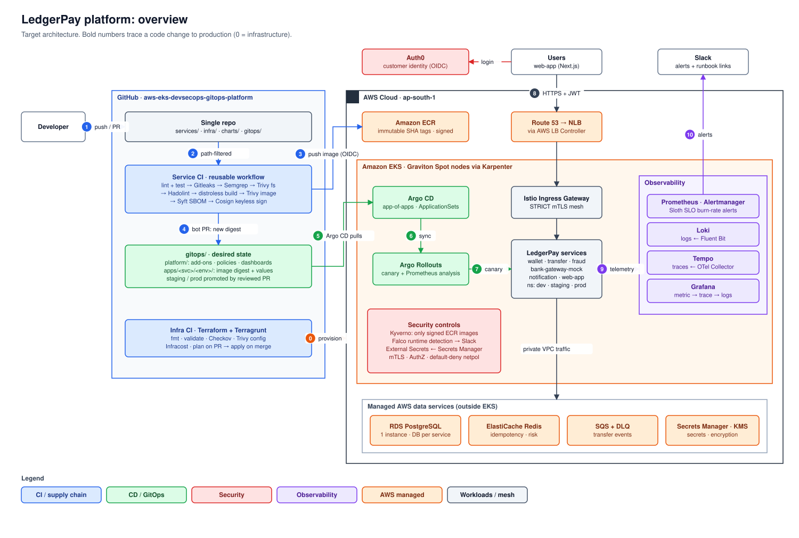

# LedgerPay — End-to-End DevSecOps & GitOps Platform on AWS EKS

> **Status: work in progress, Phase 1 (foundation, CI-first, wallet core). See the [Phase 1 plan](docs/plan/phase-1.md).** This README grows with the platform.

A production-style platform on AWS EKS, built with open-source tooling (plus Auth0's free plan for customer login). **LedgerPay**, a small digital wallet / P2P payments app, is the workload that gives the platform something real to build, secure, deploy and observe.

**The platform is the product; the app is the vehicle.**

*Target architecture. The numbers trace a code change to production. More views, such as the [AWS infrastructure](docs/architecture/README.md#1-aws-infrastructure), are in [docs/architecture](docs/architecture/README.md).*

## About LedgerPay

LedgerPay is a small digital wallet / P2P payments app. Users sign up, top up from a simulated bank, send money to each other and see their history. It is built like a real payments system:

- **Double-entry ledger** with integer amounts (paise)
- **Idempotency keys** so retries never debit twice
- **Rule-based fraud checks** on the payment path
- **A bank mock with configurable failures**
- **SQS events** for async notifications

Six small services in Go, Java, Python, Node.js and Next.js give the platform realistic polyglot workloads to build, secure, deploy and observe. Customer login is delegated to **Auth0**, the way production teams do it instead of building auth themselves.

**→ [Application design](docs/application/README.md)**: services, APIs, the money flow, failure handling and SLOs.

## What this demonstrates

- **Infrastructure as code:** Terraform modules + Terragrunt environments, and a disposable cluster (`make up` / `make destroy`) on Graviton Spot nodes via Karpenter.
- **DevSecOps CI:** secret scanning, SAST, SCA, image scanning, SBOM, keyless Cosign signing, with no static AWS credentials (GitHub OIDC).
- **GitOps CD:** Argo CD, plus Argo Rollouts canaries with automated Prometheus analysis and auto-rollback.
- **Defense in depth:** Kyverno admission (signed images only), Istio STRICT mTLS + AuthorizationPolicies, default-deny NetworkPolicies, Falco, External Secrets.
- **Cost-aware by design:** the environment is ephemeral, built with `make up` and torn down after each session at about $0.30–0.50/hour, with a nightly auto-destroy, a Python [cost-reaper](tools/cost-reaper/) for leaked resources, and budget alerts ([ADR-0002](docs/adr/0002-cost-model-ephemeral-clusters.md)).
- **Correlated observability:** Prometheus, Loki and Tempo, so you can click from a metric spike to its trace to its logs. SLOs come from Sloth with burn-rate alerts.

## Repository layout

Everything is in this one repo. The boundaries a larger organisation would draw between repos are kept as directories and enforced by CI. See [ADR-0001](docs/adr/0001-single-repository-layout.md).

| Path | Contents |
|---|---|
| [`services/`](services/) | LedgerPay microservices (code, Dockerfiles, tests) |
| [`infra/modules/`](infra/modules/) | Reusable Terraform modules |
| [`infra/live/`](infra/live/) | Terragrunt environments: dev, staging, prod |
| [`charts/`](charts/) | Helm library chart shared by all services |
| [`gitops/`](gitops/) | Argo CD source of truth: platform add-ons and per-env app config |
| [`tools/cost-reaper/`](tools/cost-reaper/) | Python CLI that finds and deletes AWS resources leaked after `make destroy` |
| [`.github/workflows/`](.github/workflows/) | Reusable CI pipeline and per-area workflows |
| [`docs/`](docs/) | Architecture, ADRs, runbooks |

## Tech stack

Every tool in the project, in the order a change meets it: from writing code to running in production. **Phase** is the [roadmap](#roadmap) phase where the tool is introduced. Everything is open source or free; the only bill is AWS infrastructure.

### 1. Application

| Tool | Why it's used | Phase |
|---|---|---|
| **Java + Spring Boot** | `wallet-service`, the money core. Mature transaction management and row locking for the double-entry ledger | 1 |
| **Maven** (+ Maven Wrapper) | Build tool for `wallet-service`; the most common in enterprise Java, declarative, and the wrapper pins its version | 1 |
| **Flyway** | Versioned SQL migrations for the ledger schema; later run as an Argo CD PreSync Job | 1 |
| **JaCoCo** | Java test coverage, enforced as a CI gate (starts at 70%) | 1 |
| **Testcontainers** | Integration tests against a real Postgres, so locking and concurrency are actually proven | 1 |
| **Go** | `transfer-service`: fast, small static binaries, a good fit for an orchestrator on the hot payment path | 4 |
| **Python + FastAPI** | `fraud-service` (rule engine) and `notification-service` (SQS consumer); quick to write and easy to read | 4, 7 |
| **Node.js** | `bank-gateway-mock`: a tiny HTTP server with tunable latency and failure for demos | 4 |
| **Next.js (React)** | `web-app`: wallet UI, with the official Auth0 SDK for login | 7 |
| **PostgreSQL** | The ledger needs ACID transactions, constraints and row locks | 1 |
| **Redis** | Idempotency keys (`transfer-service`) and fraud velocity counters (`fraud-service`); fast, with built-in TTLs | 4 |
| **Auth0** | Customer sign-up, login and MFA as a managed identity provider, so we never store passwords ([ADR-0003](docs/adr/0003-auth0-for-customer-identity.md)). The one free-plan SaaS exception | 1 |

### 2. Local development

| Tool | Why it's used | Phase |
|---|---|---|
| **Docker** | Build and run every service the same way it runs in the cluster | 1 |
| **Docker Compose** | Run services with Postgres and Redis on a laptop for free; most development happens here ([ADR-0002](docs/adr/0002-cost-model-ephemeral-clusters.md)) | 1 |
| **kind** | A free local Kubernetes cluster for testing Helm charts, Argo CD and policies before paying for EKS | 3 |
| **Make** | One consistent entry point: `make up`, `make destroy`, `make test`, `make demo` | 1 |
| **pre-commit** | Runs formatters, linters and Gitleaks before a commit leaves the laptop | 1 |

### 3. CI and software supply chain security

| Tool | Why it's used | Phase |
|---|---|---|
| **GitHub Actions** | CI/CD runner, free for public repos. One reusable workflow is the "golden pipeline" every service calls | 1 |
| **GitHub OIDC** | CI gets short-lived AWS credentials by assuming an IAM role, so no access keys are stored anywhere | 1 |
| **GitHub Environments** | Required reviewers before staging and prod promotions | 3 |
| **GitHub App (`ledgerpay-bot`)** | Lets CI open GitOps PRs with short-lived tokens instead of a personal access token | 3 |
| **Gitleaks** | Fails the build if a secret (key, token, password) is committed | 1 |
| **Semgrep CE** | Static analysis (SAST) for insecure code patterns in Go, Java, Python and JS | 1 |
| **Trivy** | One scanner for dependencies (fs), container images and IaC misconfigurations (config); fails on CRITICAL/HIGH | 1 |
| **Hadolint** | Lints Dockerfiles for bad practices (root user, unpinned packages) | 1 |
| **golangci-lint · ruff + mypy + pytest · eslint** | Per-language lint and test steps in the golden pipeline for Go, Python and Node.js services | 4 |
| **Distroless base images** | No shell or package manager in the image, so there's a smaller attack surface and fewer CVEs | 1 |
| **Docker Buildx** | Builds `linux/arm64` images for the cheaper Graviton nodes | 1 |
| **Syft** | Generates an SBOM (list of everything in the image), attached to the image as an attestation | 1 |
| **Cosign (keyless)** | Signs images using the CI's OIDC identity, with no signing keys to manage; the cluster only runs signed images | 1 |
| **Renovate** | Opens PRs to keep pinned versions (Actions SHAs, Helm charts, providers, base images) up to date | 2 |
| **Conftest (OPA)** | Tests rendered Kubernetes manifests against our policies in CI, before they reach the cluster | 3 |
| **OWASP ZAP** | Baseline DAST scan of the running staging app after each deploy | 4 |

### 4. Infrastructure as code

| Tool | Why it's used | Phase |
|---|---|---|
| **Terraform** | Declares all AWS resources and the Auth0 tenant as code | 1 |
| **Terragrunt** | Keeps dev/staging/prod configs DRY, and pins module versions per environment | 1 |
| **Checkov** | Scans Terraform for security misconfigurations (public buckets, unencrypted storage) on every PR | 1 |
| **Infracost** | Comments the monthly cost impact of each Terraform PR, so cost is reviewed like code | 1 |
| **terraform-aws-modules** (vpc, eks) | Community modules, pinned and wrapped in our own thin modules, instead of re-implementing VPC and EKS | 2 |

### 5. AWS cloud

| Tool | Why it's used | Phase |
|---|---|---|
| **VPC** | 3 AZs; public / private-app / private-data subnets; a single NAT gateway in dev to save cost | 2 |
| **EKS** | Managed Kubernetes control plane, private API endpoint, KMS-encrypted secrets | 2 |
| **EC2 Graviton (arm64)** | About 20% cheaper than x86 for the same work | 2 |
| **ECR** | Private image registry with immutable tags and scan on push | 1 |
| **RDS PostgreSQL** | Managed Postgres outside the cluster, so data survives cluster teardown and AWS handles backups | 2 |
| **ElastiCache Redis** | Managed Redis for idempotency keys and velocity counters | 4 |
| **SQS + DLQ** | Durable async events to `notification-service`; poison messages go to the dead-letter queue | 7 |
| **Route 53** | DNS for the public endpoints, with records managed by ExternalDNS | 4 |
| **Network Load Balancer** | Layer-4 entry point in front of the Istio Ingress Gateway | 4 |
| **IAM + EKS Pod Identity** | Least-privilege AWS permissions per service, with no credentials inside pods | 1, 2 |
| **IAM Identity Center** | SSO login for humans (`aws sso login`): short-lived credentials, no IAM user access keys | 1 |
| **Secrets Manager** | Single source of truth for secrets (DB passwords, Auth0 credentials), synced into the cluster | 1 |
| **KMS** | Encryption keys for EKS secrets, RDS, S3 and SQS | 2 |
| **S3** | Terraform state, Velero backups, and Loki/Tempo storage (cheap long-term storage) | 1 |
| **AWS Budgets** | Alerts at $10 / $25 / $50 so a forgotten resource never becomes a surprise bill | 1 |
| **CloudWatch alarm + SNS** | Emails when the SQS dead-letter queue has messages (free tier) | 7 |

### 6. Kubernetes platform add-ons

| Tool | Why it's used | Phase |
|---|---|---|
| **Karpenter** | Adds the right-sized Graviton Spot nodes in seconds and removes idle ones, which cuts compute cost | 2 |
| **Metrics Server** | Resource metrics for `kubectl top` and the Horizontal Pod Autoscaler | 3 |
| **AWS Load Balancer Controller** | Creates the NLB from a Kubernetes Service; no hand-made load balancers | 4 |
| **cert-manager** | Free, auto-renewing TLS certificates from Let's Encrypt | 4 |
| **ExternalDNS** | Creates Route 53 records from Kubernetes resources automatically | 4 |
| **External Secrets Operator** | Syncs Secrets Manager into Kubernetes Secrets, so nothing secret lives in Git | 3 |
| **KEDA** | Scales `notification-service` on SQS queue depth, including to zero | 7 |

### 7. GitOps and delivery

| Tool | Why it's used | Phase |
|---|---|---|
| **Helm** | One reusable library chart gives every service the same hardened Deployment, probes, limits and policies | 3 |
| **Argo CD** | Continuously syncs the cluster from `gitops/`; Git is the only way to change prod and the audit log. App-of-apps + ApplicationSets | 3 |
| **Argo Rollouts** | Canary releases (10 → 25 → 50 → 100%) that auto-abort when Prometheus analysis sees errors or latency | 4 |

### 8. Service mesh

| Tool | Why it's used | Phase |
|---|---|---|
| **Istio** | STRICT mTLS between all services, JWT validation at the gateway, per-service AuthorizationPolicies, retries, timeouts, circuit breaking, and canary traffic splitting | 4 |
| **Kiali** | Live map of which service talks to which, for debugging and demos | 5 |

### 9. Kubernetes security

| Tool | Why it's used | Phase |
|---|---|---|
| **Kyverno** | Admission control: only Cosign-signed images from our ECR, and no privileged pods, `latest` tags or missing limits | 6 |
| **Pod Security Standards (`restricted`)** | Built-in baseline: non-root, no privilege escalation, dropped capabilities | 6 |
| **NetworkPolicies (default-deny)** | A pod can only reach what it's explicitly allowed to, at the network layer | 6 |
| **Falco** | Runtime threat detection (shell in a container, unexpected outbound traffic), alerting to Slack | 6 |
| **Falcosidekick** | Forwards Falco alerts to Slack | 6 |
| **Kubescape** | CIS and NSA hardening scans of the cluster, tracked over time | 6 |

### 10. Observability

| Tool | Why it's used | Phase |
|---|---|---|
| **Prometheus** (kube-prometheus-stack) | Metrics from the cluster, Istio and every service's `/metrics`; also powers canary analysis | 4 |
| **Grafana** | Dashboards as code, plus one-click links from a metric to its trace to its logs | 5 |
| **Alertmanager** | Routes alerts to Slack, each with a runbook link | 5 |
| **Slack** | Where alerts, Falco events and cost-reaper reports land (free workspace) | 5 |
| **Fluent Bit** | Lightweight log shipper from every node to Loki | 5 |
| **Loki** | Log storage that indexes labels, not full text, so it's cheap. Chosen over ELK (much heavier) | 5 |
| **OpenTelemetry** (SDKs + Collector) | Vendor-neutral tracing in every service, collected centrally | 5 |
| **Tempo** | Trace storage on S3; trace IDs link logs and metrics together | 5 |
| **Sloth** | Generates SLO burn-rate alert rules from simple SLO definitions (e.g. 99.5% transfer availability) | 5 |
| **OpenCost** | Cost per namespace and service, so you can see what each environment costs | 7 |

### 11. Reliability and testing

| Tool | Why it's used | Phase |
|---|---|---|
| **k6** | Load tests, and the traffic generator for canary and SLO demos | 4 |
| **Chaos Mesh** | Injects pod kills, latency and network faults to prove the system recovers | 7 |
| **Velero** | Cluster backup to S3, with a tested and documented restore drill | 7 |

### 12. Automation (Python)

| Tool | Why it's used | Phase |
|---|---|---|
| **Python 3.12** | Language for [`tools/cost-reaper`](tools/cost-reaper/), which finds and deletes AWS resources left behind after `make destroy` | 2 |
| **boto3** | AWS SDK used to discover, cost and delete leaked resources | 2 |
| **Typer** | Clean, self-documenting CLI (`cost-reaper report` / `apply`) | 2 |
| **pytest + moto** | Tests against a mocked AWS, so tests never touch a real account | 2 |
| **ruff + mypy** | Linting, formatting and static type checking | 2 |

### 13. Documentation

| Tool | Why it's used | Phase |
|---|---|---|
| **Markdown ADRs** | Records every significant decision with its options and trade-offs ([docs/adr](docs/adr/)) | All |
| **draw.io** | Architecture diagrams with official AWS icons, saved as `.drawio.svg` so GitHub renders them and they stay editable | All |
| **Mermaid** | Sequence and flow diagrams as text inside Markdown, rendered by GitHub and reviewable in PRs | All |
| **Loom / YouTube** | The 5-minute demo video | 7 |

### Considered and rejected

| Tool | Why not |
|---|---|
| **Datadog / New Relic** | Paid, and hides the engineering this project exists to show |
| **ELK / OpenSearch** | Heavy JVM footprint, logs only, weaker correlation with Prometheus and Tempo |
| **Amazon Managed Prometheus / Grafana** | Paid managed services; self-hosted shows more and costs less |
| **Keycloak** | Good open-source IdP, but ~1 GB RAM on an ephemeral cluster ([ADR-0003](docs/adr/0003-auth0-for-customer-identity.md)) |
| **Okta (Workforce)** | Built for employee SSO, not app customers ([ADR-0003](docs/adr/0003-auth0-for-customer-identity.md)) |
| **fck-nat (NAT instance)** | Cheaper, but self-managed; the managed NAT gateway is the production standard ([ADR-0002](docs/adr/0002-cost-model-ephemeral-clusters.md)) |
| **Separate repos per concern** | A reviewer won't open 13 repos; boundaries are enforced inside one repo instead ([ADR-0001](docs/adr/0001-single-repository-layout.md)) |

## Architecture decisions

- [ADR-0001: Single repository with enforced internal boundaries](docs/adr/0001-single-repository-layout.md)
- [ADR-0002: Cost model: ephemeral clusters](docs/adr/0002-cost-model-ephemeral-clusters.md)
- [ADR-0003: Auth0 for customer identity](docs/adr/0003-auth0-for-customer-identity.md)

## Roadmap

Pipeline first: the DevSecOps CI exists before any business logic, so every change goes through it. Every phase is broken into milestones and one-PR tasks ([how planning works](docs/plan/README.md)); later phases are drafts, finalised just before they start.

- [ ] **Phase 1: Foundation, CI-first and wallet core** ([plan](docs/plan/phase-1.md)): repo guardrails, DevSecOps CI, AWS bootstrap (state, OIDC, ECR), signed images, Auth0 as code, `wallet-service` ledger, Docker Compose
- [ ] **Phase 2: Infrastructure** ([plan](docs/plan/phase-2.md)): VPC, EKS, RDS, Karpenter, Pod Identity; Terraform plan/apply in CI; `make up` / `make destroy`; cost-reaper; Renovate
- [ ] **Phase 3: GitOps** ([plan](docs/plan/phase-3.md)): Argo CD, Helm library chart, External Secrets, multi-env values, CI bot PRs, PR-based promotion, Conftest
- [ ] **Phase 4: Payment path, mesh and progressive delivery** ([plan](docs/plan/phase-4.md)): transfer, fraud and bank-mock services; Istio mTLS + AuthorizationPolicies, cert-manager, ExternalDNS; minimal Prometheus, Argo Rollouts canary, k6; OWASP ZAP
- [ ] **Phase 5: Observability** ([plan](docs/plan/phase-5.md)): Grafana, Alertmanager, Loki, Tempo, OTel, correlation, SLOs, alerts, dashboards, Kiali
- [ ] **Phase 6: Security hardening** ([plan](docs/plan/phase-6.md)): Kyverno + signature verification, default-deny NetworkPolicies, egress control, Falco, Kubescape, threat model
- [ ] **Phase 7: Complete and polish** ([plan](docs/plan/phase-7.md)): notification-service + SQS, web-app, KEDA, Velero restore drill, Chaos Mesh, load tests, OpenCost, demo video

## How I work

Solo project, run the way a team would run it:

- Work comes from the phase plans in [`docs/plan/`](docs/plan/README.md): **one task = one branch = one PR**, merged only when CI is green.
- Commits follow [Conventional Commits](https://www.conventionalcommits.org/) with the plan task in the footer (`Refs: P1-02`), so every change traces back to a task.
- Local guardrails: `make bootstrap-dev` installs the pre-commit hooks (formatting checks and Gitleaks); `make lint` runs them on every file.
- Significant decisions get an [ADR](docs/adr/); anything that costs money is torn down with `make destroy`.

## Definition of done

The project is portfolio-ready when all of these are true, each with linked evidence:

- [ ] One-command bring-up and teardown of the full environment
- [ ] A commit to any service flows through scanning, signing, GitOps PR and canary rollout with no manual `kubectl`
- [ ] Unsigned or non-compliant images are rejected by the cluster
- [ ] Injected failure in `bank-gateway-mock` triggers canary auto-rollback, an SLO burn-rate alert in Slack and a traceable root cause in Grafana
- [ ] Velero restore drill documented and tested
- [ ] README with architecture diagram, setup guide, screenshots/GIFs; ADRs and runbooks written; 5-minute demo video recorded

## Demo scenario

Push a code change → CI scans, builds, signs and opens a GitOps PR → merge → Argo CD syncs → Argo Rollouts starts a canary → raise `FAILURE_RATE` on `bank-gateway-mock` → analysis fails and the rollout auto-aborts → Slack alert fires with a runbook link → click from the Grafana error spike to the failing trace in Tempo to its logs in Loki.

## License and contributions

[MIT](LICENSE). This is a personal portfolio project, so it does not accept contributions; pull requests and issues from outside will be closed. You are welcome to read, fork and learn from it.
