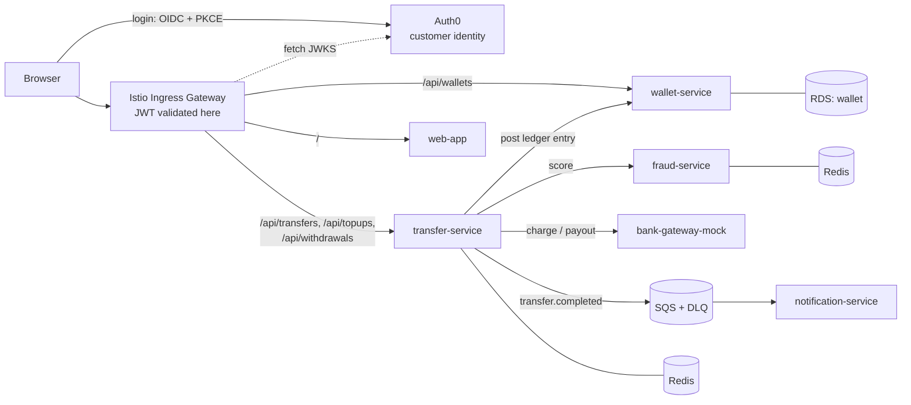
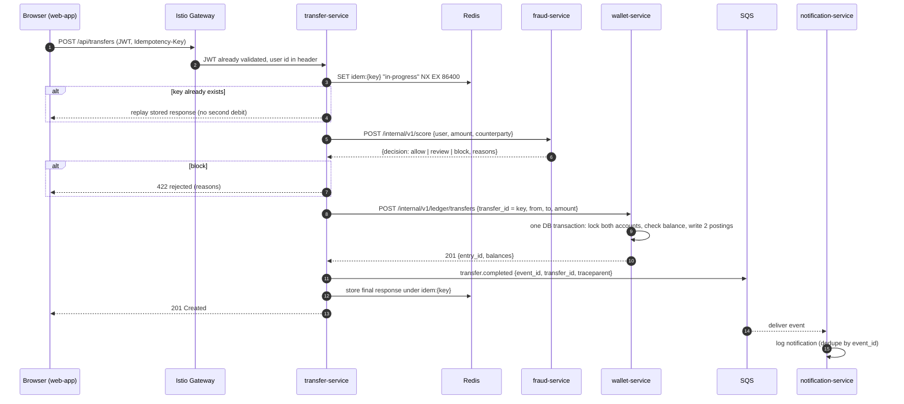

# LedgerPay: application design

LedgerPay is a small digital wallet and peer-to-peer payments app, similar in spirit to Paytm or PhonePe wallets. Users sign up, top up their wallet from a (simulated) bank, send money to other users, and see their transaction history.

The app is deliberately small (a few endpoints per service), but it is built the way a real payments system is. That gives the platform real problems to handle: correctness of money movement, idempotent retries, risk checks, flaky external dependencies, async events, and service-to-service authorization.

> **Status:** design. Phase 1 sets up the Auth0 tenant (as code) and builds `wallet-service`; the rest arrive in later phases.

## What a user can do

| Journey | Services involved |
|---|---|
| Sign up and log in | web-app → **Auth0** Universal Login (OIDC + PKCE) |
| See balance | web-app → wallet-service |
| Top up the wallet from a bank | web-app → transfer-service → bank-gateway-mock → wallet-service |
| Send money to another user | web-app → transfer-service → fraud-service → wallet-service → SQS → notification-service |
| See transaction history | web-app → wallet-service |
| Withdraw to a bank | web-app → transfer-service → wallet-service → bank-gateway-mock |

## Services

| Service | Language | Owns | Responsibility |
|---|---|---|---|
| `web-app` | Next.js | — | UI: login, dashboard, send money, history |
| `wallet-service` | Java (Spring Boot) | Postgres DB `wallet` | Accounts, balances, **double-entry ledger**; the only writer of money |
| `transfer-service` | Go | Redis (idempotency keys) | Orchestrates transfers, top-ups and withdrawals |
| `fraud-service` | Python (FastAPI) | Redis (velocity counters) | Rule-based risk score: allow, review or block |
| `bank-gateway-mock` | Node.js | — | Fake external bank/UPI with tunable latency and failure rate |
| `notification-service` | Python | — | Consumes transfer events from SQS and "sends" notifications (structured logs) |
| **Auth0** (external SaaS) | — | User identities | Sign-up, login, MFA, issues JWT access tokens, publishes JWKS. See [ADR-0003](../adr/0003-auth0-for-customer-identity.md) |

Each service owns its data. No service reads another service's database or Redis keys. Postgres (one RDS instance) holds only the `wallet` database today; any future service that needs SQL gets its own logical database and credentials on the same instance.

## Architecture



### Who may call whom

This table is the source of truth for Istio AuthorizationPolicies and NetworkPolicies. Anything not listed is denied.

| Caller | May call |
|---|---|
| Ingress gateway | `web-app`, `wallet-service` (public routes), `transfer-service` (public routes) |
| `transfer-service` | `fraud-service`, `wallet-service` (`/internal/*`), `bank-gateway-mock`, SQS |
| `notification-service` | SQS (consume) |
| `wallet-service`, `fraud-service`, `bank-gateway-mock` | nothing (leaf services; only their own data stores) |
| Istio gateway and services | Auth0 JWKS endpoint (egress allow-list) |

`/internal/*` routes are never exposed at the gateway, and only `transfer-service`'s identity (mTLS SPIFFE ID) may call them.

## Main flow: send money



Top-up and withdrawal follow the same pattern. For a top-up, `bank-gateway-mock` charges the user's bank and the wallet is then credited. For a withdrawal, the wallet is debited first and then paid out; if the payout fails, it is reversed with a compensating ledger entry.

## Key design decisions

### Money is integers, in a double-entry ledger

- Amounts are stored as **integer minor units** (paise; ₹1 = 100) in `BIGINT`. Never floats.
- Single currency (INR) to keep scope small.
- Every money movement is a **journal entry** with two or more **postings** that sum to zero: debit one account, credit another. Top-ups and withdrawals post against a `bank_settlement` system account. The books always balance, and the history is append-only: corrections are new entries, never updates.
- A balance can't go negative. `wallet-service` locks the affected account rows (`SELECT … FOR UPDATE`, in a consistent order to avoid deadlocks) and checks the balance inside the same transaction.

```
accounts        (id, user_sub UNIQUE, email, type[user|bank_settlement], currency, balance_minor, created_at)  -- user_sub = Auth0 'sub'
journal_entries (id, transfer_id UNIQUE, kind[transfer|topup|withdrawal|reversal], created_at)
postings        (id, entry_id → journal_entries, account_id → accounts, amount_minor)  -- signed; per entry SUM = 0
```

`balance_minor` is a cached running total updated in the same transaction as the postings, so reads are fast. It can always be rebuilt from `postings`.

### Idempotency end to end

- `POST /api/transfers`, `/api/topups` and `/api/withdrawals` **require** an `Idempotency-Key` header (UUID). The web-app generates one per submit, so a double-click or network retry never moves money twice.
- `transfer-service` records the key in Redis with `SET NX` (24h TTL) and replays the stored response for repeats.
- The same key is passed to `wallet-service` as `transfer_id`, which has a **unique constraint**. Even if Redis were flushed, the ledger refuses a duplicate. The real guarantee lives in the database.

### Authentication: Auth0

Customer identity is delegated to **Auth0**. We don't store passwords or build login flows ([ADR-0003](../adr/0003-auth0-for-customer-identity.md)).

- **Login:** the web-app uses the Auth0 Next.js SDK. The browser goes through Auth0 Universal Login (Authorization Code + PKCE) and comes back with a short-lived **access token** (RS256 JWT) for the LedgerPay API audience. Sign-up, password reset, email verification and MFA are all Auth0 features we configure rather than build.
- **Validation at the edge:** an Istio `RequestAuthentication` trusts Auth0's issuer and JWKS URL. An `AuthorizationPolicy` rejects `/api/*` requests that have no valid token before they reach any pod.
- **Validation in the service too:** services also verify the token (Spring Security resource server in Java, JWT middleware in Go). That's defense in depth, and it's what keeps auth working in local Docker Compose, where there is no Istio.
- **User identity:** services key everything on the token's `sub` claim (e.g. `auth0|65f…`). `wallet-service` creates the wallet on first use and stores `sub` and the verified `email`, so users can send money to an email address.
- **Service-to-service calls don't use Auth0.** Internal calls are authorized by Istio mTLS identities (SPIFFE IDs) and AuthorizationPolicies. That costs no Auth0 machine-to-machine tokens and works offline.
- **Tenant as code:** the Auth0 tenant (API, SPA application, connections, branding, MFA policy) is managed with the official Auth0 Terraform provider under `infra/`. The provider's client secret lives in AWS Secrets Manager, and CI reads it through its OIDC role, so no credential is stored in GitHub.
- **Environments:** one Auth0 tenant per environment class (`ledgerpay-dev`, `ledgerpay-prod`), each with its own issuer, audience and callback URLs.

### Fraud rules (no ML)

`fraud-service` scores each transfer from simple, explainable rules. Velocity counters live in Redis.

| Rule | Effect |
|---|---|
| Single transfer > ₹50,000 | block |
| More than 5 transfers in 10 minutes (sliding window) | block |
| First transfer to this recipient and amount > ₹10,000 | review (allowed, flagged in logs and metrics) |
| Daily outgoing total > ₹1,00,000 | block |

Thresholds come from environment variables. The point is a realistic synchronous dependency on the payment path, with its own latency and SLO.

### bank-gateway-mock: the failure lever for demos

| Env var | Effect |
|---|---|
| `FAILURE_RATE` | Fraction (0–1) of requests that return `503` |
| `LATENCY_MS` | Added latency per request |

These two variables drive the platform demos: retries and timeouts, Istio circuit breaking (outlier detection), canary analysis failing and auto-rolling back, and SLO burn-rate alerts. For example, setting `FAILURE_RATE=0.3` during a canary should trigger an automatic rollback.

### Async events

`transfer-service` publishes events to SQS after the ledger commit:

```json
{
  "event_id": "uuid",
  "type": "transfer.completed",
  "occurred_at": "2026-10-13T10:15:00Z",
  "transfer_id": "idempotency key",
  "from_user": "uuid",
  "to_user": "uuid",
  "amount_minor": 150000,
  "currency": "INR"
}
```

- The W3C `traceparent` travels as an SQS message attribute, so the trace continues across the async hop into `notification-service`.
- Delivery is at least once. `notification-service` deduplicates by `event_id`. After 3 failed receives, a message goes to the **DLQ**, which has an alert.
- **Known gap:** if `transfer-service` crashes between the ledger commit and the SQS publish, the event is lost. The production fix is a **transactional outbox**, which is listed as a future improvement rather than hidden.

### Failure handling

| Failure | Behaviour |
|---|---|
| `fraud-service` down or slow (>500 ms) | **Fail closed**: transfer rejected with 503. This is a payment system, so it doesn't skip risk checks. |
| `wallet-service` fails after fraud allowed | Nothing was debited; 503. The client retries with the same key, which is safe. |
| `bank-gateway-mock` slow or failing | 2 s timeout, 2 retries with backoff (Istio), circuit breaker opens on repeated 5xx |
| Payout fails after wallet debit | Compensating `reversal` ledger entry restores the balance |
| SQS publish fails | Retried with backoff; see the outbox note above |

## API summary

Public routes go through the gateway under `/api` and need an Auth0 access token. Internal routes are mesh-only.

| Service | Method and path | Purpose |
|---|---|---|
| Auth0 | Universal Login, `/oauth/token`, `/.well-known/jwks.json` | Sign-up, login, tokens, signing keys (hosted by Auth0) |
| wallet | `GET /api/wallets/me` | Balance (creates the wallet on first call) |
| wallet | `GET /api/wallets/me/transactions?cursor=` | Paginated history |
| wallet | `GET /internal/v1/accounts?email=` | Resolve a recipient by email (transfer-service only) |
| wallet | `POST /internal/v1/ledger/transfers` | Atomic debit and credit (transfer-service only) |
| wallet | `POST /internal/v1/ledger/topups` · `/withdrawals` · `/reversals` | Bank-side postings (transfer-service only) |
| transfer | `POST /api/transfers` | Send money; `Idempotency-Key` required |
| transfer | `POST /api/topups` · `POST /api/withdrawals` | Bank in and out; `Idempotency-Key` required |
| fraud | `POST /internal/v1/score` | Risk decision |
| bank-gateway-mock | `POST /v1/charges` · `POST /v1/payouts` | Simulated bank |

Exact request and response schemas are published per service as OpenAPI files in `services/<svc>/openapi.yaml` as each service is built.

## What every service must provide

These are the platform contract. CI and the Helm library chart assume them.

- `GET /healthz` (liveness: the process is up), `GET /readyz` (readiness: dependencies are reachable), `GET /metrics` (Prometheus format, including RED metrics: rate, errors, duration)
- OpenTelemetry tracing with W3C `traceparent` propagation, inbound and outbound
- Structured JSON logs to stdout with `timestamp`, `level`, `service`, `trace_id`, `span_id`, `message`
- Configuration only through environment variables; secrets injected by External Secrets
- Graceful shutdown on SIGTERM: stop accepting requests, finish in-flight ones, then exit
- Unit tests, a multi-stage distroless Dockerfile (`linux/arm64`, non-root), Helm values under `gitops/apps/<svc>/`

## SLOs (initial targets)

| SLO | Target | Measured at |
|---|---|---|
| Transfer availability (non-5xx on `POST /api/transfers`) | 99.5% over 30 days | Istio gateway metrics |
| Transfer latency | 95% of requests < 800 ms | Istio gateway metrics |
| Notification delivery | 99% of events processed < 60 s | notification-service metrics |

Defined as code with Sloth; multi-window burn-rate alerts go to Slack with runbook links.

## Build order

| Phase | Application work |
|---|---|
| 1 | Auth0 tenant as code + `wallet-service` with the full service contract; Docker Compose with Postgres |
| 4 | `transfer-service`, `fraud-service`, `bank-gateway-mock` (the payment path the canary and mesh demos need) |
| 7 | `notification-service` + SQS events, `web-app` |
