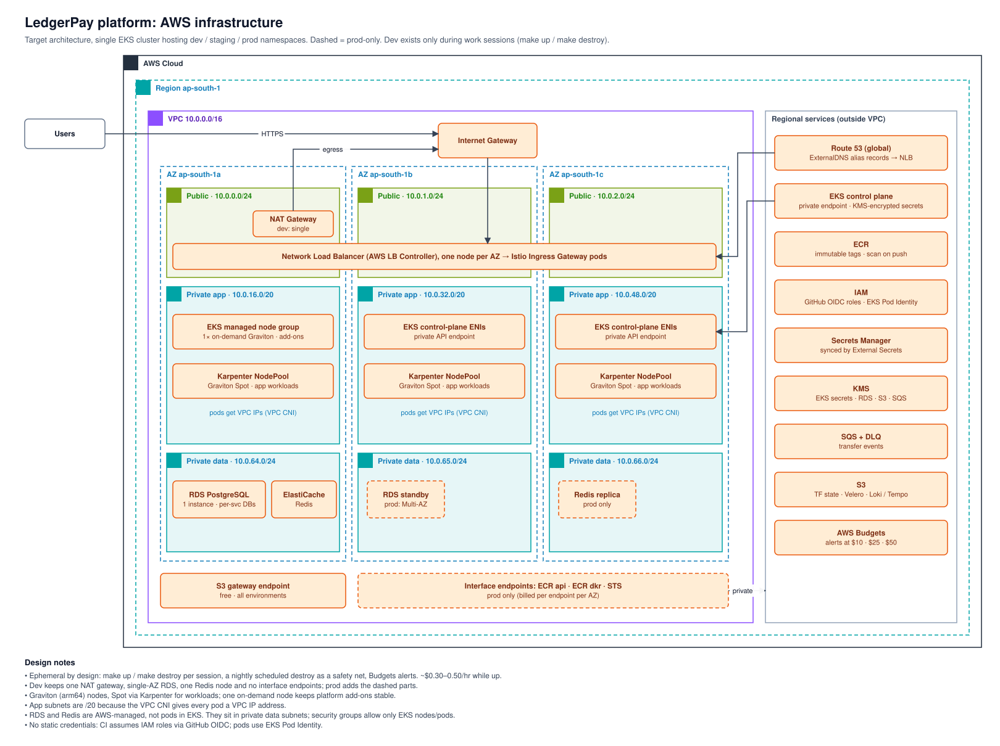

# Architecture

The diagrams go from the big picture down to one concern each. Every `.drawio.svg` file renders on GitHub as an image and opens for editing in [draw.io](https://app.diagrams.net) or the VS Code Draw.io Integration extension.

**Colours:** CI / supply chain = blue · CD / GitOps = green · Security = red · Observability = purple · AWS managed = orange · Workloads / mesh = slate. Dashed outlines mean prod-only or optional.

| # | Diagram | Status |
|---|---|---|
| 0 | [Platform overview](#0-platform-overview) | Target, nothing built yet |
| 1 | [AWS infrastructure](#1-aws-infrastructure) | Target, built in Phase 2 |
| 2 | CI / supply chain | Planned (Phase 1, task P1-20) |
| 3 | CD / GitOps and promotion | Planned (Phase 3–4) |
| 4 | Runtime / request flow | Planned (Phase 4) |
| 5 | Security layers | Planned (Phase 6) |
| 6 | Observability and correlation | Planned (Phase 5) |

## 0. Platform overview

How a code change reaches production:

0. **Infra CI** provisions AWS with Terraform/Terragrunt, using an OIDC-assumed role (plan on PR, apply on merge).
1. **A developer** pushes to a branch and opens a PR.
2. **Path filters** start CI only for the service that changed.
3. **The reusable service workflow** lints, tests and scans the code, then builds a distroless image, generates an SBOM, signs it with Cosign and pushes it to ECR under the git SHA. AWS access uses GitHub OIDC; there are no stored keys.
4. **A bot PR** writes the new image digest to `gitops/apps/<svc>/dev/`. Staging and prod are promoted later by reviewed PRs that move the same digest.
5. **Argo CD** pulls `gitops/`. The cluster pulls its config; CI never pushes to the cluster.
6. **Argo CD syncs** the Rollout.
7. **Argo Rollouts** shifts traffic 10 → 25 → 50 → 100% while Prometheus analysis checks error rate and p99 latency. A failing analysis aborts and rolls back automatically.
8. **Users** log in with **Auth0** and call the API with its JWT through Route 53 → NLB → Istio Ingress Gateway. The gateway validates the token before any pod sees the request; inside the mesh, traffic uses STRICT mTLS.
9. **Every service** emits metrics, JSON logs and OTel traces into Prometheus, Loki and Tempo. Grafana links a metric spike to its trace and then to its logs.
10. **SLO burn-rate alerts** go to Slack with a runbook link.

Kyverno admits only Cosign-signed images from our ECR. Secrets come from Secrets Manager through External Secrets and never touch Git.

## 1. AWS infrastructure

Key decisions:

- **Three AZs, three subnet tiers.** Public subnets hold only the NLB and NAT. Nodes and data stores live in private subnets.
- **Ephemeral dev ([ADR-0002](../adr/0002-cost-model-ephemeral-clusters.md)):** the environment exists only during work sessions (`make up` / `make destroy`), with a nightly scheduled destroy and Budgets alerts as safety nets. Dev runs one NAT gateway, single-AZ RDS, one Redis node and no interface endpoints. Prod adds the dashed parts (NAT per AZ, Multi-AZ RDS, Redis replica, interface endpoints).
- **Managed data stores outside the cluster.** RDS PostgreSQL and ElastiCache are AWS-managed services, not pods in EKS. They sit in private data subnets, and their security groups allow traffic only from EKS nodes and pods. There is **one RDS instance** holding the `wallet` database; any future SQL-backed service gets its own logical database and user on it. Services never share tables, but we pay for one instance. User identities live in Auth0, not in our database.
- **/20 app subnets**, because the VPC CNI gives every pod a VPC IP. Small subnets run out of IPs before they run out of CPU.
- **Two kinds of nodes, all Graviton (arm64):** one on-demand managed node for platform add-ons that must stay up, and Karpenter Spot NodePools for app workloads.
- **Private EKS API endpoint**, with public access restricted to known CIDRs and Kubernetes secrets encrypted with KMS.
- **VPC endpoints:** the S3 gateway endpoint is free and always on. Interface endpoints (ECR api/dkr, STS) keep image pulls off the NAT, but cost about $85/month across 3 AZs, so they are prod-only.
- **One cluster, three environments as namespaces**, to save cost. Terragrunt keeps per-environment folders so prod can move to its own cluster later. See [ADR-0001](../adr/0001-single-repository-layout.md) for the repo side of the same thinking.

## Editing the diagrams

1. Open the `.drawio.svg` file in draw.io (desktop, web or VS Code).
2. Edit it and save. draw.io rewrites the SVG preview and the embedded model together, so GitHub always shows the latest version.
3. Keep the colour legend consistent across diagrams, and update the status table above.
