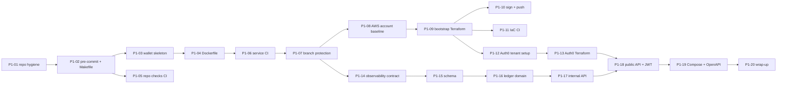

# Phase 1: Foundation, CI-first and wallet core

> **ID key:** **P** = Phase, **M** = Milestone. `P1-M3` = Phase 1, Milestone 3 · `P1-06` = Phase 1, task 06. Task numbers run through the whole phase, so every ID is unique and searchable in commits, PRs and issues.

**Goal:** before any business logic exists, every push already goes through the DevSecOps pipeline, signed images land in ECR, and the Auth0 tenant is code. Then `wallet-service` (the double-entry ledger) is built feature by feature, each PR passing through that pipeline.

**Exit criteria** (all must hold):

- [ ] `main` is protected; merging needs a PR with green required checks
- [ ] A merge that changes `services/wallet-service/**` produces an image in ECR tagged with the git SHA, **Cosign-signed**, with an SBOM attestation, and `cosign verify` passes
- [ ] The CI fails on a planted secret, a CRITICAL/HIGH CVE, a Dockerfile lint error and a coverage drop (each proven once, then reverted)
- [ ] The Auth0 dev tenant is fully defined in Terraform; `plan` shows no drift
- [ ] Locally: `make up-local` → get a dev token → check balance → top up → transfer → history reconciles to the cent
- [ ] AWS spend for the phase stays under **$1/month** (no cluster yet)

## Milestones

| Milestone | Outcome | Tasks |
|---|---|---|
| [P1-M1 Repo foundation](#p1-m1-repo-foundation) | Clean repo on GitHub with local guardrails | P1-01 – P1-02 |
| [P1-M2 Walking skeleton](#p1-m2-walking-skeleton) | A minimal `wallet-service` the pipeline can build | P1-03 – P1-04 |
| [P1-M3 CI v1 (no AWS)](#p1-m3-ci-v1-no-aws) | Every push is scanned; `main` protected | P1-05 – P1-07 |
| [P1-M4 AWS bootstrap + CI v2](#p1-m4-aws-bootstrap--ci-v2) | Signed images pushed to ECR via OIDC | P1-08 – P1-11 |
| [P1-M5 Auth0 as code](#p1-m5-auth0-as-code) | Tenant defined and applied with Terraform | P1-12 – P1-13 |
| [P1-M6 Ledger](#p1-m6-ledger) | Working wallet API locally, every PR through CI | P1-14 – P1-20 |

---

## P1-M1 Repo foundation

### P1-01: Repo hygiene and first push
- **Why:** a clean, conventional repo that reviewers and tools understand, published to GitHub.
- **Scope:**
  - `.gitattributes` (force LF line endings, important on Windows/WSL)
  - `.editorconfig`
  - `LICENSE` (MIT)
  - `.github/CODEOWNERS`
  - `.github/pull_request_template.md`
  - README "How I work" and "License and contributions" sections (solo project: no `CONTRIBUTING.md`, outside contributions not accepted)
  - Commit the existing docs; connect the GitHub remote; push `main`
- **Out of scope:** CI workflows, branch protection
- **Acceptance criteria:**
  - [ ] Repo is public on GitHub; README, diagrams and Mermaid render correctly
  - [ ] `git ls-files --eol` shows LF for all text files
- **Depends on:** —
- **Runs on:** local + GitHub
- **Output:** repo root, `.github/`

### P1-02: pre-commit and Makefile skeleton
- **Why:** catch secrets and formatting problems before they leave the laptop.
- **Scope:**
  - `.pre-commit-config.yaml`: trailing whitespace, end-of-file, YAML/JSON checks, large-file guard, merge-conflict markers, **Gitleaks**; hooks pinned to versions
  - Root `Makefile` with `help`, `lint` (runs pre-commit on all files) and `bootstrap-dev` (installs the hooks)
- **Out of scope:** language-specific linters (they come with each service)
- **Acceptance criteria:**
  - [ ] `make lint` passes on a clean tree
  - [ ] Committing a fake AWS key is blocked locally
- **Depends on:** P1-01
- **Runs on:** local
- **Output:** `.pre-commit-config.yaml`, `Makefile`

## P1-M2 Walking skeleton

### P1-03: wallet-service skeleton
- **Why:** give the pipeline something real to build, test and scan, with no business logic yet.
- **Scope:**
  - Spring Boot project in `services/wallet-service` with the Maven Wrapper; Java and Spring Boot versions verified and pinned (Java 21 LTS, the mainstream LTS with a distroless image, chosen over 25 since nothing needs 25 yet; current Spring Boot major)
  - `/healthz` (liveness) and `/readyz` (readiness) via Actuator health groups; config from environment variables only; graceful shutdown on SIGTERM
  - One unit test, one web-layer test
  - `make test` and `make run` targets for the service
- **Out of scope:** database, metrics, auth, ledger logic
- **Acceptance criteria:**
  - [ ] `./mvnw verify` passes; JaCoCo report generated
  - [ ] `curl localhost:8080/healthz` returns `UP`; SIGTERM shuts down cleanly within the grace period
- **Depends on:** P1-02
- **Runs on:** local
- **Output:** `services/wallet-service/`

### P1-04: Hardened multi-arch Dockerfile
- **Why:** the image is what we sign and deploy, so it's hardened from the first version.
- **Scope:**
  - Multi-stage build: the builder runs on `$BUILDPLATFORM` (native speed); the runtime is **distroless Java, non-root**, with no shell
  - Works with a read-only root filesystem (writable `/tmp` only)
  - Base images pinned by digest; `.dockerignore`
  - `docker buildx build --platform linux/amd64,linux/arm64` works locally
- **Out of scope:** pushing anywhere
- **Acceptance criteria:**
  - [ ] Hadolint reports no issues
  - [ ] Container runs as a non-root UID with `--read-only --cap-drop=ALL`, and `/healthz` is UP
  - [ ] `trivy image` shows no CRITICAL/HIGH vulnerabilities (or each one is documented in `.trivyignore` with a reason)
- **Depends on:** P1-03
- **Runs on:** local
- **Output:** `services/wallet-service/Dockerfile`, `.dockerignore`

## P1-M3 CI v1 (no AWS)

### P1-05: Repo-wide checks workflow
- **Why:** some checks apply to every change, whatever path it touches.
- **Scope:** `.github/workflows/repo-checks.yml`, run on every push and PR:
  - pre-commit on all files
  - Gitleaks over the full history
  - Least-privilege `permissions:`; actions pinned by commit SHA; `concurrency` cancels superseded runs
- **Acceptance criteria:**
  - [ ] Green on `main`
  - [ ] A PR with a planted test secret fails (proven, then reverted)
- **Depends on:** P1-02
- **Runs on:** GitHub Actions
- **Output:** `.github/workflows/repo-checks.yml`

### P1-06: Reusable service CI workflow (golden pipeline v1)
- **Why:** one pipeline every service calls, so security gates can't be skipped per service.
- **Scope:**
  - `.github/workflows/service-ci.yml` (`workflow_call`), with inputs for the service path and language
  - Stages in order:
    1. Lint + unit tests + coverage gate (JaCoCo ≥ 70%)
    2. Semgrep CE
    3. Trivy fs
    4. Hadolint
    5. Multi-arch buildx build
    6. Trivy image (fail on CRITICAL/HIGH)
    7. Syft SBOM uploaded as an artifact
  - Thin caller `wallet-service.yml`, path-filtered to `services/wallet-service/**`
  - A job summary showing scan results
- **Out of scope:** pushing, signing (P1-10); the GitOps PR (Phase 3); ZAP (Phase 4)
- **Acceptance criteria:**
  - [ ] Changing only `docs/` does **not** run the service pipeline
  - [ ] Each gate is proven to fail once: a vulnerable dependency, a Dockerfile lint error, coverage below the gate
  - [ ] Runs in under 10 minutes, using dependency and layer caching
- **Depends on:** P1-04, P1-05
- **Runs on:** GitHub Actions
- **Output:** `.github/workflows/service-ci.yml`, `.github/workflows/wallet-service.yml`, `services/wallet-service/.trivyignore`

### P1-07: Protect main
- **Why:** turn "every change goes through CI" from intention into enforcement.
- **Scope:**
  - Repository ruleset on `main`: PR required, required status checks (repo checks + service CI), linear history, no force-push, no deletion
  - **0 required approvals and no required code-owner review:** this is a solo project and GitHub doesn't let you approve your own PR; the required checks are the gate
  - Issues, Discussions and Wiki off; interaction limits set to collaborators only
  - Documented in `docs/runbooks/github-repo-settings.md`
- **Acceptance criteria:**
  - [ ] A direct push to `main` is rejected
  - [ ] A PR with a failing check can't be merged
- **Depends on:** P1-06
- **Runs on:** GitHub
- **Output:** `docs/runbooks/github-repo-settings.md`

## P1-M4 AWS bootstrap + CI v2

### P1-08: AWS account baseline (manual, one-time)
- **Why:** a secure account before any Terraform runs against it.
- **Scope:**
  - Root user MFA; no root access keys
  - **IAM Identity Center** admin user with MFA; `aws sso login` profile
  - Default region `ap-south-1`
  - Each step documented as a runbook
- **Acceptance criteria:**
  - [ ] `aws sts get-caller-identity` works through SSO, and no IAM user access keys exist
- **Depends on:** —
- **Runs on:** AWS console ($0)
- **Output:** `docs/runbooks/aws-account-baseline.md`

### P1-09: `infra/bootstrap` Terraform
- **Why:** the long-lived, near-free foundation that CI and later phases need. It is never destroyed.
- **Scope:** plain Terraform (it creates the state bucket, so it can't depend on it; it starts with local state, then migrates into the bucket):
  - **S3 state bucket:** versioning, SSE-S3 encryption, public access blocked, S3-native lockfile
  - **AWS Budgets:** alerts at $10 / $25 / $50
  - **GitHub OIDC provider**
  - **IAM role `ledgerpay-ci-ecr-push`:** trust limited to this repo, the `main` branch and the service-CI workflow; permissions limited to pushing to the LedgerPay ECR repositories
  - **ECR repository `ledgerpay/wallet-service`:** immutable tags, scan on push, lifecycle policy keeping the last 20 images
  - All resources tagged `project=ledgerpay` and `ledgerpay/protected=true`
- **Out of scope:** VPC, EKS, everything that costs per hour (Phase 2)
- **Acceptance criteria:**
  - [ ] `terraform plan` is clean after apply; Checkov passes
  - [ ] Infracost estimate is under $1/month
- **Depends on:** P1-08
- **Runs on:** local with SSO credentials. **AWS apply needs your approval** (cost: about $0.10/month plus storage)
- **Output:** `infra/bootstrap/`

### P1-10: CI v2: sign and push
- **Why:** complete the supply chain: only signed, scanned images reach the registry.
- **Scope:**
  - On `main` only: assume the CI role via OIDC
  - Push the multi-arch image tagged with the **git SHA**
  - **Cosign keyless sign** by digest
  - Attach the SBOM as a Cosign attestation
  - `cosign verify` as a final step
  - PRs still build and scan but never push
- **Acceptance criteria:**
  - [ ] No AWS secrets exist in GitHub
  - [ ] `cosign verify` with the expected workflow identity passes for the pushed digest
  - [ ] The image tag in ECR equals the merge commit SHA; pushing the same tag again is rejected (immutable)
- **Depends on:** P1-06, P1-09
- **Runs on:** GitHub Actions + AWS (ECR storage, cents)
- **Output:** `.github/workflows/service-ci.yml`

### P1-11: IaC CI
- **Why:** infrastructure code gets the same gates as application code.
- **Scope:** `.github/workflows/infra-ci.yml`, path-filtered to `infra/**`:
  - `terraform fmt -check` and `validate`
  - Checkov
  - Trivy config
- **Out of scope:** `plan` and `apply` from CI (Phase 2, which needs a Terraform role)
- **Acceptance criteria:**
  - [ ] A deliberately public S3 bucket in a test PR fails Checkov
- **Depends on:** P1-09
- **Runs on:** GitHub Actions
- **Output:** `.github/workflows/infra-ci.yml`

## P1-M5 Auth0 as code

### P1-12: Auth0 tenant setup (manual, one-time)
- **Why:** Terraform needs a tenant and a machine credential to manage it.
- **Scope:**
  - Free Auth0 account; tenant `ledgerpay-dev`
  - A machine-to-machine app for Terraform with only the Management API scopes it needs
  - Its credentials stored in **AWS Secrets Manager**, never in Git or GitHub
  - A runbook
- **Acceptance criteria:**
  - [ ] Terraform can read the credentials using your SSO session; nothing is stored locally in plain text
- **Depends on:** P1-09
- **Runs on:** Auth0 + AWS (Secrets Manager: about $0.40/month)
- **Output:** `docs/runbooks/auth0-tenant-setup.md`

### P1-13: Auth0 Terraform module and dev config
- **Why:** the identity configuration is reviewable, reproducible code.
- **Scope:**
  - `infra/modules/auth0`:
    - API (resource server): RS256, audience `https://api.ledgerpay.dev`, 15-minute access tokens
    - SPA application for web-app (localhost callbacks for now)
    - Database connection
    - MFA policy
    - An **Auth0 Action** that adds the verified email as a namespaced claim to access tokens. wallet-service needs it for "send to email"; access tokens don't include it by default
    - A **dev-only CLI client** with the password grant, used only to get test tokens locally. Documented as a dev-only trade-off and never created in prod
  - `infra/live/dev/auth0` using **Terragrunt**, with state in the bootstrap bucket
- **Acceptance criteria:**
  - [ ] `terragrunt apply` creates the tenant config; a second `plan` shows no changes
  - [ ] IaC CI is green
  - [ ] A token from the dev CLI client decodes with the correct `iss`, `aud`, `sub` and email claim
- **Depends on:** P1-11, P1-12
- **Runs on:** local + Auth0 (free)
- **Output:** `infra/modules/auth0/`, `infra/live/dev/auth0/`, `infra/live/terragrunt.hcl`

## P1-M6 Ledger

From here on, every task is a normal feature PR through the full pipeline.

### P1-14: Observability contract
- **Why:** the platform contract (logs, metrics, traces) is in place before the features that need it.
- **Scope:**
  - Structured JSON logs with `timestamp`, `level`, `service`, `trace_id`, `span_id`
  - Micrometer Prometheus metrics at `/metrics` (request rate, errors, duration)
  - OpenTelemetry Java agent in the image, configured by env; exporter disabled by default locally
- **Acceptance criteria:**
  - [ ] A request produces one JSON log line with a `trace_id`
  - [ ] `/metrics` exposes `http_server_requests_seconds`
- **Depends on:** P1-07
- **Runs on:** local
- **Output:** `services/wallet-service/`

### P1-15: Ledger schema (Flyway)
- **Why:** the database enforces correctness, not just the code.
- **Scope:**
  - Migration `V1__ledger.sql`:
    - `accounts` (`user_sub` unique, `email`, `type`, `currency`, `balance_minor BIGINT`)
    - `journal_entries` (`transfer_id` **unique**, `kind`)
    - `postings` (signed `amount_minor`)
  - `CHECK` constraints (non-negative user balance, INR only)
  - A deferred constraint trigger that rejects any journal entry whose postings don't sum to zero
  - System account `bank_settlement` seeded
- **Acceptance criteria:**
  - [ ] Testcontainers test: an unbalanced entry is rejected **by the database**
  - [ ] A duplicate `transfer_id` is rejected
- **Depends on:** P1-14
- **Runs on:** local
- **Output:** `services/wallet-service/src/main/resources/db/migration/`

### P1-16: Ledger domain logic
- **Why:** the core money rules, as pure and well-tested code.
- **Scope:**
  - Money as `long` minor units
  - Create the wallet on first use
  - Post transfer, top-up, withdrawal and reversal entries
  - Balance and history queries
  - Unit tests for every rule (balanced postings, insufficient funds, reversal restores the balance)
- **Acceptance criteria:**
  - [ ] Coverage of the domain package ≥ 90%
  - [ ] No floating-point types touch money (enforced by a Semgrep rule)
- **Depends on:** P1-15
- **Runs on:** local
- **Output:** `services/wallet-service/src/main/java/.../ledger/`

### P1-17: Internal ledger API
- **Why:** the API `transfer-service` will call in Phase 4.
- **Scope:**
  - `POST /internal/v1/ledger/{transfers,topups,withdrawals,reversals}`
  - `GET /internal/v1/accounts?email=`
  - `SELECT … FOR UPDATE` on both accounts, always locked in a consistent order (prevents deadlocks)
  - Replaying the same `transfer_id` returns the original result (201 the first time, 200 on replay)
- **Out of scope:** network-level protection of `/internal/*` (Istio in Phase 4; documented as a local-only gap)
- **Acceptance criteria:**
  - [ ] Concurrency test: 50 parallel transfers from one account never overdraw it, and all balances reconcile
  - [ ] Replay test: the same key sent twice moves money once
- **Depends on:** P1-16
- **Runs on:** local
- **Output:** `services/wallet-service/`

### P1-18: Public API + Auth0 JWT validation
- **Why:** real user-facing endpoints, secured with real tokens.
- **Scope:**
  - Spring Security resource server; issuer and audience from env
  - `GET /api/wallets/me` (creates the wallet on first call from `sub` + email claim)
  - `GET /api/wallets/me/transactions?cursor=` (cursor pagination)
  - `/healthz`, `/readyz` and `/metrics` stay unauthenticated
- **Acceptance criteria:**
  - [ ] No token → 401; wrong audience → 401; valid token → 200
  - [ ] Tests use signed test JWTs (no network calls to Auth0 in CI)
- **Depends on:** P1-13, P1-17
- **Runs on:** local
- **Output:** `services/wallet-service/`

### P1-19: Local stack, OpenAPI and service docs
- **Why:** anyone can run and understand the service in a few minutes.
- **Scope:**
  - Root `docker-compose.yml` (wallet-service + Postgres, with health checks)
  - `make up-local` / `make down-local`
  - `scripts/get-dev-token.sh` (dev CLI client → access token)
  - `services/wallet-service/openapi.yaml`, validated in CI
  - Service README
- **Acceptance criteria:**
  - [ ] From a fresh clone: `make up-local`, get a token, then balance → top-up → transfer → history works, following only the README
- **Depends on:** P1-18
- **Runs on:** local
- **Output:** `docker-compose.yml`, `scripts/`, `services/wallet-service/openapi.yaml`, `services/wallet-service/README.md`

### P1-20: Phase 1 wrap-up
- **Why:** close the phase with evidence, not just "done".
- **Scope:**
  - **Diagram #2, CI and supply chain** (Mermaid) in `docs/architecture/`
  - Verify every exit criterion and link the evidence (CI run, `cosign verify` output)
  - Update the README roadmap and status
  - Short retrospective: what to change in Phase 2
- **Acceptance criteria:**
  - [ ] All exit criteria at the top of this file are ticked, each with a link
- **Depends on:** all of the above
- **Runs on:** local
- **Output:** `docs/architecture/`, `README.md`, `docs/plan/phase-1.md`

---

## Cost of Phase 1

| Item | ~USD/month |
|---|---|
| S3 state bucket + ECR storage | < 0.20 |
| Secrets Manager (1 secret) | 0.40 |
| AWS Budgets, IAM, OIDC provider | 0 |
| Auth0 (free plan), GitHub Actions (public repo) | 0 |
| **Total** | **< $1** |
